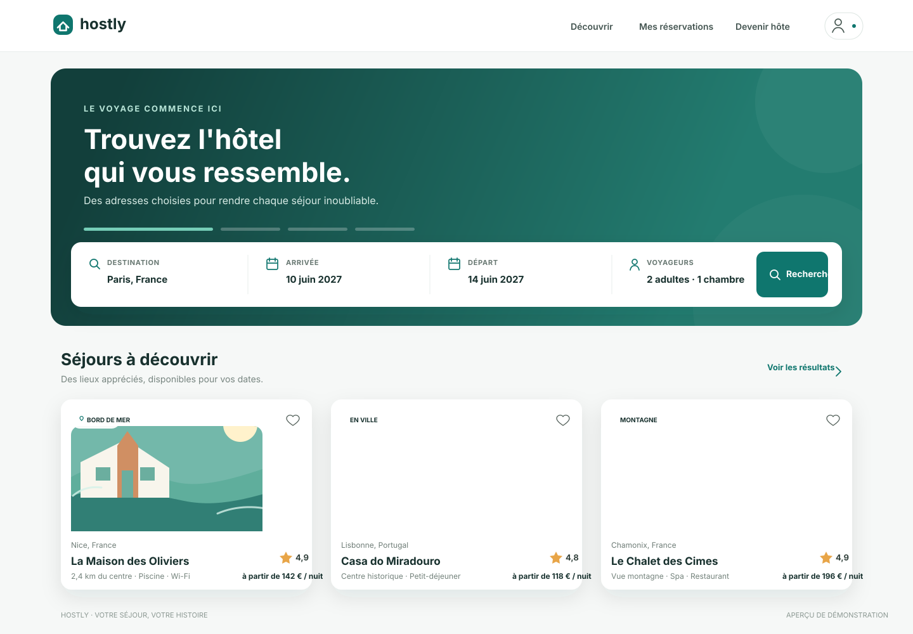

# Hostly — Hotel Booking App

Hostly est un projet de réservation d'hôtels construit autour de la stack MERN
(MongoDB, Express, React et Node.js). Le dépôt contient actuellement les premiers
modèles Mongoose, une route de recherche d'hôtels et une page React de résultats.
La configuration des serveurs, l'authentification, les réservations, le paiement
et les tests restent à mettre en place.

## Aperçu de démonstration

Maquette de la page d'accueil et des résultats de recherche (aperçu statique,
l'application n'est pas encore configurée pour être lancée) :



## Fonctionnalités présentes

- Modèles Mongoose `User`, `Hotel`, `Room` et `Booking`.
- Recherche d'hôtels publiés par ville ou pays, avec dates et disponibilité.
- Filtres de recherche pour les voyageurs, chambres, type, équipements, prix et note.
- Page de résultats responsive avec pagination et prise en charge du thème sombre.

## Structure actuelle

```text
backend/
└── src/
    ├── controllers/
    │   └── hotelController.js
    ├── models/
    │   ├── Booking.js
    │   ├── Hotel.js
    │   ├── Room.js
    │   └── User.js
    └── routes/
        └── hotelRoutes.js
frontend/
└── src/
    └── pages/
        ├── HotelSearchPage.css
        └── HotelSearchPage.jsx
```

## Prérequis

- Node.js et npm.
- MongoDB pour faire fonctionner le backend une fois son serveur configuré.

## Configuration et démarrage

Le dépôt ne contient pas encore de `package.json`, de point d'entrée Express ou
de configuration React. Il n'est donc pas encore possible de lancer l'application
avec `npm install` ou `npm run dev`.

Lors de la configuration du serveur Express, montez les routes hôtels ainsi :

```js
import hotelRoutes from "./routes/hotelRoutes.js";

app.use("/api/hotels", hotelRoutes);
```

La page React interroge `GET /api/hotels/search`. Configurez le proxy du serveur
frontend ou l'URL de l'API en fonction de votre environnement.

Exemple de requête :

```text
GET /api/hotels/search?destination=Paris&checkIn=2027-06-10&checkOut=2027-06-14&adults=2&children=0&rooms=1
```

Filtres optionnels disponibles : `roomType`, `roomAmenity` (répétable ou séparé
par des virgules), `amenity` (répétable ou séparé par des virgules), `minPrice`,
`maxPrice`, `minRating`, `page` et `limit`.

## Modèles et disponibilité

Les modèles se trouvent dans `backend/src/models`. Le champ `password` de
l'utilisateur n'est pas renvoyé par défaut ; le hachage du mot de passe doit
être effectué dans le flux d'inscription avant l'enregistrement.

La recherche déduit la disponibilité en comparant les réservations `pending` et
`confirmed` aux dates demandées. Le flux de réservation devra refaire cette
vérification lors de la confirmation, idéalement avec une stratégie adaptée aux
réservations concurrentes.

## Sécurité

- Ne commitez jamais de fichier `.env` ou de secret.
- Hachez les mots de passe avant leur stockage.
- Validez et autorisez les opérations protégées côté serveur.
- Vérifiez de nouveau la disponibilité et le prix au moment de réserver.
